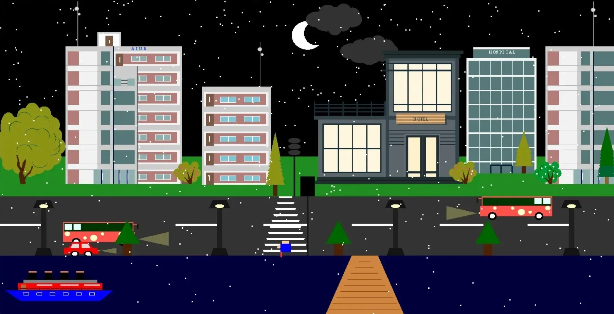
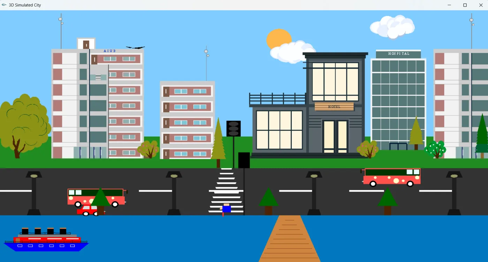
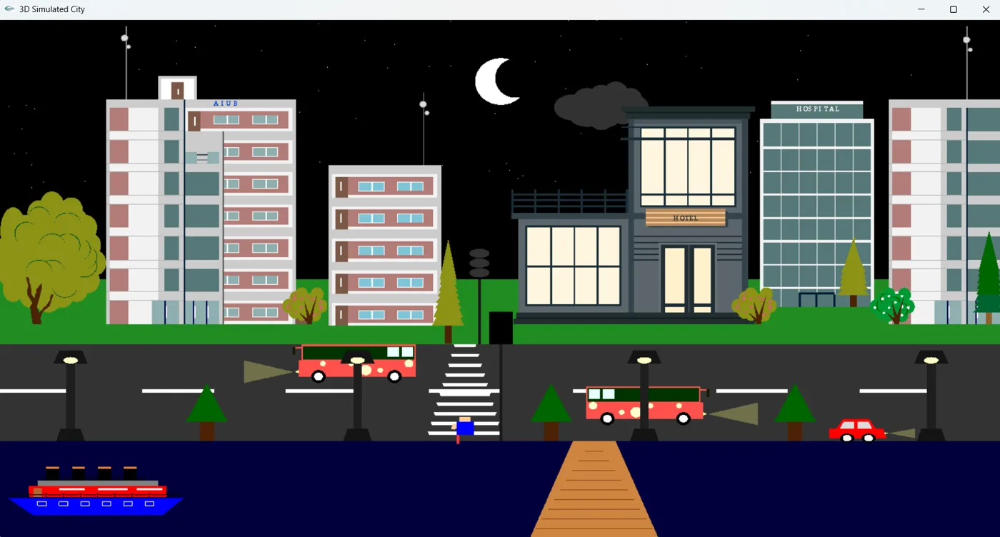
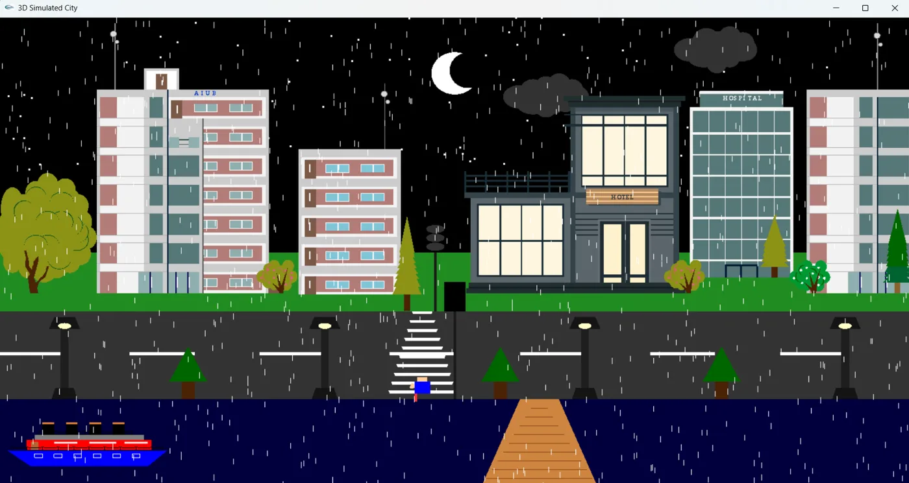
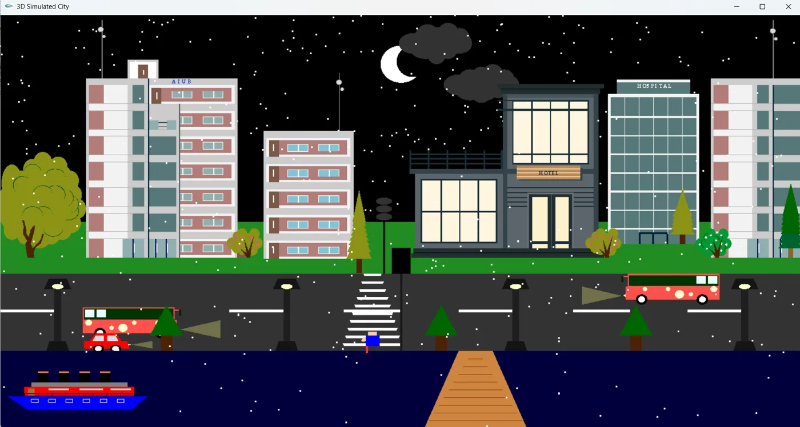
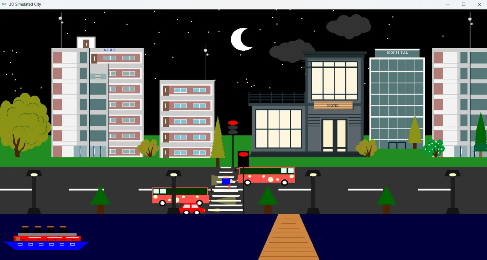
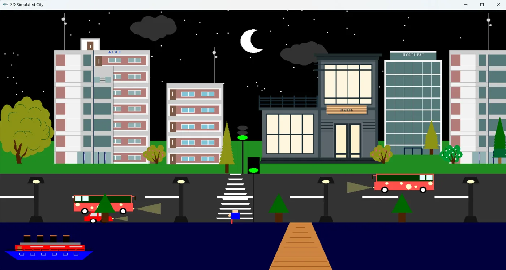
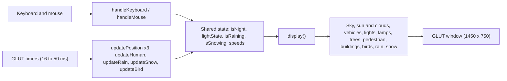

<div align="center">
  

  <p><code>An animated OpenGL and GLUT city scene with day and night, rain, snow and traffic lights, built by a team of three at AIUB.</code></p>

  <p>
    <a href="https://github.com/Saji-d/3d-city-simulation-opengl"></a>
    
    <a href="LICENSE"></a>
  </p>
  <p>
    
    
    
    
  </p>

  <p>
    <a href="#-overview">Overview</a> ·
    <a href="#-highlights">Highlights</a> ·
    <a href="#-preview">Preview</a> ·
    <a href="#-controls">Controls</a> ·
    <a href="#-architecture">Architecture</a> ·
    <a href="#-tech-stack">Tech Stack</a> ·
    <a href="#-getting-started">Getting Started</a> ·
    <a href="#-roadmap">Roadmap</a> ·
    <a href="#-author">Author</a>
  </p>
</div>


## ◈ Overview

A single-file C++ program that draws an animated city street in OpenGL and reacts to keyboard and mouse input. The scene has buildings (including an AIUB block, a hotel and a hospital), a road with a crosswalk, street lamps, trees, a river with a ship, birds, a sun and moon with clouds and stars at night.

It is an **academic Computer Graphics project** by a team of three. Despite the window title "3D Simulated City", the rendering is a **2D orthographic scene** (`glOrtho`) drawn with immediate-mode OpenGL. There is no physics engine, no AI and no 3D camera.

<table>
  <tr>
    <td width="50%" valign="top"><b>Team</b><br>Sajidur Rahman Sajid, Sidratul Muntaha and Tasnim Firdaus Emon.</td>
    <td width="50%" valign="top"><b>My part</b><br>The animation work: moving vehicles, traffic lights, pedestrian, day and night, rain and snow, and birds.</td>
  </tr>
</table>


## ◈ Highlights

<table>
  <tr>
    <td width="33%" valign="top"><b>Day and night</b><br>One key switches sky colour, stars, moon, lamp posts and vehicle headlights.</td>
    <td width="33%" valign="top"><b>Particle rain</b><br>Up to 1000 raindrops with individual speeds, toggled on demand.</td>
    <td width="33%" valign="top"><b>Particle snow</b><br>Up to 500 flakes falling slowly; rain and snow never run together.</td>
  </tr>
  <tr>
    <td valign="top"><b>Traffic lights</b><br>Red, yellow and green states set by the keyboard. Vehicles stop at the crosswalk on red.</td>
    <td valign="top"><b>Pedestrian crossing</b><br>A walking figure with a step animation that waits while vehicles have the road.</td>
    <td valign="top"><b>Moving traffic</b><br>Buses and cars on timer loops with adjustable speed, plus a ship and birds.</td>
  </tr>
</table>


## ◈ Preview

<div align="center">
  
</div>

<br>

<table>
  <tr>
    <td width="50%"><br><sub><b>Day mode</b></sub></td>
    <td width="50%"><br><sub><b>Night mode with headlights</b></sub></td>
  </tr>
  <tr>
    <td><br><sub><b>Rain</b></sub></td>
    <td><br><sub><b>Snow</b></sub></td>
  </tr>
  <tr>
    <td><br><sub><b>Red light: vehicles stopped</b></sub></td>
    <td><br><sub><b>Green light: vehicles moving</b></sub></td>
  </tr>
</table>


## ◈ Controls

Keys are read in `handleKeyboard` and the mouse in `handleMouse` in `src/main.cpp`.

| Input | Action |
| --- | --- |
| `N` or `n` | Night mode |
| `D` or `d` | Day mode |
| `B` or `b` | Toggle rain (turns snow off) |
| `P` or `p` | Toggle snow (turns rain off) |
| `R` or `r` | Red light: vehicles stop before the crosswalk |
| `Y` or `y` | Yellow light |
| `G` or `g` | Green light: vehicles move |
| `w` (lower case) | Increase bus and car speed by 0.2 |
| `s` (lower case) | Decrease bus and car speed by 0.2 (never below 0.2) |
| Left mouse button | Increase bus speed |
| Right mouse button | Decrease bus speed |


## ◈ Architecture

The program is one translation unit. GLUT timers advance the state variables and call `glutPostRedisplay`, and `display()` redraws every layer in order.



Traffic logic is state-driven: `lightState` is 0 for red, 1 for yellow and 2 for green. Buses and the car check it against a crosswalk position and hold still on red. The pedestrian crosses while the light is red and waits at the crosswalk on yellow and green.


## ◈ Tech Stack

| Layer | Technologies | Purpose |
| --- | --- | --- |
| Language | C++ | The whole scene in `src/main.cpp` (about 5.3k lines) |
| Graphics | OpenGL (immediate mode) | Primitives, colours and orthographic projection |
| Windowing | GLUT or FreeGLUT | Window, timers, keyboard and mouse |
| Build | Code::Blocks project | `Project/Simulation City.cbp` links `glut32` and `opengl32` |
| Platform | Windows | The source includes `windows.h` |


## ◈ Getting Started

**Prerequisites:** Windows, a C++ compiler (MinGW) and GLUT or FreeGLUT configured for your IDE.

```bash
git clone https://github.com/Saji-d/3d-city-simulation-opengl.git
cd 3d-city-simulation-opengl
```

Open `Project/Simulation City.cbp` in Code::Blocks, make sure `glut32` and `opengl32` are available to the linker, then build and run. With a plain MinGW setup the equivalent command is:

```bash
g++ src/main.cpp -o city -lfreeglut -lopengl32 -lglu32
```

Library names depend on how GLUT is installed on your machine.


## ◈ Roadmap

- [x] Day and night, rain and snow
- [x] Traffic lights with stopping vehicles and a crossing pedestrian
- [ ] Cycle the traffic light automatically instead of by key
- [ ] Make the keys case-insensitive for speed control
- [ ] Remove the `windows.h` dependency for Linux and macOS builds
- [ ] Split the single source file into modules


## ◈ Author

**Sajidur Rahman Sajid**: Full-Stack Developer and AI engineer from Dhaka. BSc in CSE at American International University-Bangladesh (AIUB).

<p>
  <a href="https://www.sajidur.me"></a>
  <a href="https://www.linkedin.com/in/sajidur-rahman-sajid/"></a>
  <a href="https://github.com/Saji-d"></a>
  <a href="mailto:sajidsajidurrahman99@gmail.com"></a>
</p>

<sub>A Computer Graphics course project, shared as it was built.</sub>
